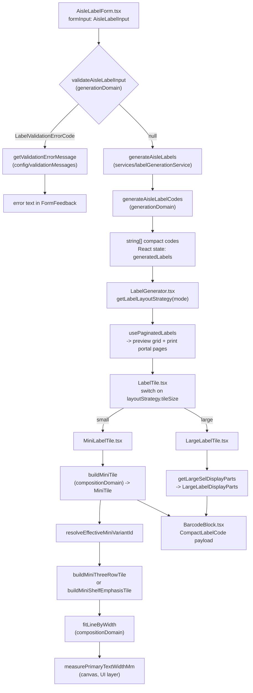

# AGENTS Guidance

## Core Objective

This project is A4 print-first. The primary and non-negotiable use case is printing shelf edge labels on A4 SEL paper for 39mm x 39mm mini labels and A4 SEL paper for 73mm x 105mm large labels.
This has to be millimeter perfect to ensure the labels fit within the perforated lines on the paper.
Protect physical label accuracy and scan reliability before making UI/UX changes.

## Non-Negotiable Geometry Rules

- Keep all label and page geometry in millimeters (mm).
- Do not convert print geometry to px/rem/%.
- Canonical values:
  - Mini-label: 39mm x 39mm
  - A4 margins: left 11mm, right 12mm, top 7.5mm, bottom 7.5mm
  - Large-label: 73mm x 105mm
  - A4 margins: left 0mm, right 0mm, top 0mm, bottom 5mm

## Dependency Version Constraints

- **TypeScript must stay on 5.x** (`^5.x.x`). `typescript-eslint` (and its dependency `ts-api-utils`, used by `eslint-plugin-sonarjs`) has a hard runtime block on TypeScript 7.0 and does not yet support TypeScript 6.1+. Upgrading TypeScript past `<6.1.0` will break `npm run lint` entirely. Before upgrading TypeScript, verify that `typescript-eslint` peer deps cover the target version — see <https://github.com/typescript-eslint/typescript-eslint/issues/10940> for tracking.

## Feature-Specific Constraints

### Shelf Range Selection (AisleLabelForm)

- Shelf ranges are defined by start and end letters (`A`–`Z`).
- Start shelf defaults to `A` when omitted; end shelf is required.
- Validation enforces start ≤ end; invalid ranges are rejected with `VALIDATION_MESSAGES.shelfOrder`.
- The shelf count in summary display shows `"A – C"` format for ranges and single letters for `start === end`.

### Large Label Support (SpecificLabelForm)

- Aisle and shortcode values render correctly with the three-part display (prefix / main / suffix).
- Special aisle values (`FLORAL`, `KIOSK`) are **blocked** on large-sel mode with `VALIDATION_MESSAGES.specificLargeSelSpecialCode`.
- Reason: `getLargeSelDisplayParts()` returns `null` for special codes, resulting in empty heading text on a 105mm label.
- Validation blocks generation immediately; mode switches clear stale output to prevent visual bypass.
  This blocking is intentional to avoid complexity in large labels, in the absence of any actual user requirement.

## Rendering Path Awareness

- Screen preview and print portal use the same `LabelTile` render path.
- `LabelTile` dispatches to layout-specific rendering based on `layoutStrategy.tileSize` (`'small'` or `'large'`), not `layoutStrategy.mode`.

## Domain Pipeline Map

Read this before changing domain logic. It is the single description of how a form entry becomes a printed label.



Data shape at each hop:

| Stage               | Type                       | Example                                                            |
| ------------------- | -------------------------- | ------------------------------------------------------------------ |
| Form state          | `AisleLabelInput`          | `{ aisleStart: 1, aisleEnd: 2, sideRanges, shelfStart, shelfEnd }` |
| Generated batch     | `string[]`                 | `['01L01A', '01L02A']`                                             |
| Parsed code         | `ParsedLabelCode`          | `{ kind: 'aisle', parts: { aisle, side, bay, shelf } }`            |
| Mini display parts  | `MiniThreeRowDisplayParts` | `{ top: '01', main: 'L01', bottom: 'A' }` (**vertical**)           |
| Large display parts | `LargeLabelDisplayParts`   | `{ prefix: '01', main: 'L01', suffix: 'A' }` (**horizontal**)      |
| Mini tile           | `MiniTile`                 | discriminated: `MiniThreeRowTile` \| `MiniShelfEmphasisTile`       |
| Barcode payload     | `CompactLabelCode`         | `'01L01A'` (branded, separator-free)                               |

Two behaviours in this pipeline are not visible from the call sites:

- **Text measurement is inverted.** `fitLineByWidth` lives in the domain but calls back into the UI (`measurePrimaryTextWidthMm`, canvas-based) to measure glyph width, which in turn falls back to the domain's `estimatePrimaryTextWidthMm` when no canvas exists (SSR/tests). The domain owns the fitting algorithm; the UI owns only the measurement.
- **Shelf-emphasis cannot render special codes.** `resolveEffectiveMiniVariantId` downgrades `mini-shelf-emphasis` to `mini-three-row` for `FLORAL`/`KIOSK` before composition, because those codes have no shelf token to enlarge. The downgrade is silent by design: there is no error and no user-visible signal.

`buildMiniTile` returns a **discriminated union**, not a flattened shape. Each variant owns its own field names and every field is required:

- `MiniThreeRowTile` — `topLineText` / `mainLineText` / `bottomLineText` plus matching mm centres, `auxTextSizeMm`, and font weights.
- `MiniShelfEmphasisTile` — `shelfLineText` / `fullCodeLineText` plus their mm centres, sizes, and font weights.

`MiniLabelTile.tsx` switches once on `tile.variantId`; the compiler guarantees each branch's fields, so no `??` fallbacks are needed. Do not reintroduce optional fields to "share" a type between the two variants.

## Domain Glossary

One term, one meaning, one owning module. Prefer these words over synonyms.

| Term                | Meaning                                                                                                                                                       | Owned by                              |
| ------------------- | ------------------------------------------------------------------------------------------------------------------------------------------------------------- | ------------------------------------- |
| code                | Scannable label value, e.g. `01L01A`                                                                                                                          | `src/domain/codesDomain.ts`           |
| compact             | Separator-free barcode payload (`getEncodedLabelCode`)                                                                                                        | `codesDomain.ts`                      |
| spaced              | Human-readable display form `01 L01 A` (`getSpacedLabelCode`)                                                                                                 | `codesDomain.ts`                      |
| parts               | Parsed code tokens (`AisleCodeParts`, `ShortCodeParts`, `SpecialCodeParts`)                                                                                   | `codesDomain.ts`                      |
| display parts       | Parts reshaped for rendering. Mini is **vertical** (`top`/`main`/`bottom`); large is **horizontal** (`prefix`/`main`/`suffix`). Different axes, not synonyms. | `codesDomain.ts`                      |
| composition variant | Which mini text arrangement is used (`mini-three-row`, `mini-shelf-emphasis`)                                                                                 | `src/domain/compositionDomain.ts`     |
| layout strategy     | Discriminated union of the full mm spec per paper: `MiniLabelLayoutStrategy` \| `LargeLabelLayoutStrategy`                                                    | `src/config/labelLayoutStrategies.ts` |
| tileSize            | Tile size `'small' \| 'large'` on the layout strategy. **Not** a composition variant.                                                                         | `labelLayoutStrategies.ts`            |
| mode                | `LabelPrintMode` (`'mini-sel' \| 'large-sel'`), the user-facing paper choice                                                                                  | `labelLayoutStrategies.ts`            |
| geometry            | Positions and maximum text sizes in mm, **before** fitting                                                                                                    | `compositionDomain.ts`                |
| typography fit      | Resolved text sizes and weights in mm, **after** fitting                                                                                                      | `compositionDomain.ts`                |
| bounds / limits     | Validation configuration (`minAisleValue`, `maxBayValue`)                                                                                                     | `src/config/labelConfig.ts`           |
| range               | A user-supplied start-to-end span                                                                                                                             | `src/domain/generationDomain.ts`      |

## Label Safety Rules

- Preserve barcode module width/height and quiet-zone assumptions unless explicitly changing barcode spec.
- Avoid changes that visually look better on screen but risk print scan reliability.
- Validate scan-critical changes with real print output whenever possible.

## Barcode Encoding Rules

- **Only compact input is accepted** (no dashes or spaces in user input).
- Compact input (`01L01A`, `BR10L01A`, `BM10L01A`, `BAK01A`, `KIOSK`) is parsed directly to constituent parts (aisle token, side, bay, shelf).
- Prefixed aisle tokens are allow-listed by configuration (default `BR`, `BL`, `FL`, `FR`, `PD`, `BM`) and their numeric suffix is validated against configured aisle min/max bounds.
- Shelf tokens are **alphabetical only** (`A`-`Z`) for aisle and short label codes.
- **Barcode payload is always compact**, identical to the input after uppercasing.
- Display text uses font size and weight for visual treatment only — this is a rendering concern, not an input format.
- Encoding logic lives in `src/domain/codesDomain.ts`; `getEncodedLabelCode()` parses compact input and emits a `CompactLabelCode` branded payload (a `string` subtype that prevents accidental use of display-formatted codes as barcode values).
- Scanner reliability depends on compact, separator-free payloads.

## Validation Gates

- Fast local validation gate: `npm run validate:ci`
- `validate:ci` runs style typing, style audit, `prettier:check`, `lint`, `lint:naming`, `lint:complexity`, `test:run`, and `build:bundle`
- GitHub Pages deploy workflow quality gate: `validate:ci` checks plus `npm run audit:prod`
- Full release validation gate: `npm run validate:release`
- `validate:release` runs `validate:ci`, `npm run audit:prod`, `npm run test:a11y`, and `npm run test:e2e`
- If E2E tests all fail at launch after dependency updates (missing Playwright browser executable), run `npm run test:e2e:install` before re-running `npm run test:e2e` or `npm run validate:release`.
- Coverage remains available when needed: `npm run test:coverage`
- Visual regressions remain available when needed: `npm run test:visual`
- Update visual baselines only for intentional UI changes: `npm run test:visual:update`

## Naming Conventions Standard

- Components use PascalCase symbols and PascalCase file names (for example `AisleLabelForm.tsx`).
- Hooks use camelCase with a `use` prefix and `use*.ts`/`use*.tsx` file names.
- Non-component modules (domain/config/services/utils) use camelCase file names.
- Type aliases, interfaces, and exported model types use PascalCase.
- Module-level constants use UPPER_SNAKE_CASE; local constants use camelCase.
- Boolean identifiers should use `is*`, `has*`, `can*`, or `should*` prefixes.
- Event handlers should use a `handle*` prefix.
- Naming lint (`npm run lint:naming`) enforces hook export names (`use*`) and file naming rules as errors; violations must be fixed before merge.
- Boolean-prefix checks are included in `lint:naming` as warnings to surface drift without forcing broad legacy churn.

## Naming Refactor Protocol

- For naming-focused changes, provide a before/after rename table before making edits.
- Keep naming aligned with existing repo conventions in this file, especially:
  - Boolean identifiers use `is*`, `has*`, `can*`, or `should*` prefixes.
  - Service module naming and verb-oriented exports.
  - Established domain terms (avoid introducing new synonyms for existing concepts).
- Run naming checks before and after naming changes, and report delta results.
- If a proposed rename changes domain terminology, confirm intent before applying.

## Complexity-First Rule

- Before implementing non-trivial changes, run `npm run lint:complexity` to establish a baseline in files likely to be touched.
- If a target function is near/over threshold, plan extractions or helper splits before adding new branches.
- In touched files, complexity should stay flat or improve; avoid adding logic that pushes functions over threshold unless there is a strong reason.
- When higher complexity is unavoidable, document why and add/adjust tests that cover the new branches.

## Skills Check Invocation

- For Copilot code reviews, explicitly request the `react-best-practices` skill.
- For testability/maintainability reviews, explicitly request the `code-review-quality` skill.
- Include all four parts in the prompt:
  - Skill: `react-best-practices`
  - Scope: files/folders to review
  - Evidence: `npm run validate:ci` or `npm run validate:release`
  - Output: findings first, ordered by severity, with file references
- For `code-review-quality`, keep the same structure but set Skill to `code-review-quality` and focus scope on test files and impacted source files.
- Preferred shortcut prompt: `Do a react-best-practices skills check, full repo, include validate:release, findings first.`
- Preferred test-review shortcut prompt: `Use code-review-quality to review tests in src/components and tests/e2e, include npm run validate:release, findings first with actionable fixes.`

## Visual Regression Scope

- Snapshot baselines live under `tests/e2e/visual-baselines.spec.ts-snapshots`.
- Keep at least one full-page (35 mini-labels) preview snapshot using default configuration.

## Change Discipline

- Make minimal, targeted edits.
- Do not modify `node_modules`.
- Do not remove defensive branches just to improve coverage; add tests to cover them.
- If removing platform-specific references, remove only first-party references in repo files.

## Post-Feature Review Checklist

After feature implementation passes all validation gates (`npm run validate:ci` and `npm run validate:release`), conduct a proactive code review pass for maintainability:

### Duplication Detection**

- Identical constants, state patterns, or JSX blocks appearing in multiple files (for example the `PRINT_MODE_OPTIONS` constant and `labelPrintMode` state duplicated across `AisleLabelForm.tsx` and `SpecificLabelForm.tsx`).
- Extract to reusable hooks, components, or config constants.
- Repeated state initialization patterns (e.g., `useState`, `useCallback`) that could be encapsulated in a custom hook.

### Pattern Recognition**

- Common form patterns (RadioGroup, validation error display) that could be consolidated.
- Identical validation logic across multiple input components.
- Repeated JSX blocks that differ only in prop values.

### Cognitive Load & Clarity**

- Are files doing too much? Can concerns be better separated?
- Would extracting a custom hook reduce boilerplate in a component?
- Are variable/function names clear and consistent across similar code?

**When to Flag as Refactoring Opportunity**: If duplication affects three or more instances, or if consolidation significantly improves maintainability without creating harmful coupling, propose extraction.

**When to Skip**: If duplication is intentionally defensive (decoupled implementations prevent unexpected interaction), document the decision in a comment.

**Action**: Before handing off completed features, proactively identify DRY/maintainability wins and propose extraction or consolidation — do not wait for user feedback to surface duplication.

## Validation Architecture: Domain Error Code Boundary

- Domain validation functions never return message strings directly. They return a typed value (a discriminated union `{ code: ... }` for aisle/short, or a `reason` string literal for specific labels), and `src/config/validationMessages.ts` owns mapping that typed value to display text (`getValidationErrorMessage`, `getSpecificInvalidLabelMessage`). This keeps domain logic pure/testable and centralizes UI copy (and future i18n) in one place.
- `LabelValidationErrorCode` (aisle/short) and `SpecificLabelValidationErrorReason` (specific labels) are both **owned by `validationMessages.ts`**, not by the domain files that use them — `src/domain/generationDomain.ts` and `src/domain/codesDomain.ts` import the type back from config. This is intentionally symmetric across all three label forms.
- The specific-label error message names the actual offending code (e.g. `Label 'F0S01A' is not a recognized label format...`) rather than a generic "invalid input" message, so a typo in a multi-code batch is identifiable. `src/services/specificLabelValidationService.ts` finds the first invalid `{code, reason}` pair and passes both to `getSpecificInvalidLabelMessage`.
- Do not add a _new_ parallel error-code type when extending validation elsewhere — reuse this existing boundary (typed value from domain, text mapping in `validationMessages.ts`) rather than introducing message strings composed ad hoc in components/hooks.

## React / TypeScript Approach

- Prefer function components with typed props interfaces; keep public prop contracts explicit and stable.
- Use CSS Modules with `.module.css` files and generated `.module.css.d.ts` typings; do not reintroduce `.module.scss` unless explicitly requested.
- Keep state as close as possible to where it is used, but lift shared configuration state to the nearest common parent.
- Use controlled inputs for form fields so generated label output is deterministic and testable.
- Preserve existing data flow: input components collect values, generator components produce code arrays, and rendering components display labels.
- Keep barcode formatting logic in pure helper functions where possible; avoid embedding formatting rules directly in JSX.
- Reuse existing render paths (`LabelTile` and `LabelGenerator`) instead of creating parallel render trees for similar output.
- Use `useMemo` and `useEffect` only when they clarify behavior or prevent real recomputation; avoid adding hook complexity without benefit.
- Preserve accessibility roles and labels used by tests (`tab`, `tabpanel`, `alert`, button names), and update tests if labels intentionally change.
- Prefer small, targeted constants for tunable rendering values (text size, offsets, label dimensions) instead of magic literals in loops.
- Keep TypeScript changes strict enough to catch regressions, but avoid broad refactors unless explicitly requested.

## Component-Specific Guidance

### Pagination (`src/components/print/Pagination.tsx`)

- **Do not include `currentPage` in the `useEffect` dependency array** when syncing to `totalPages`. Use functional `setState` to depend only on `totalPages`:

  ```typescript
  React.useEffect(() => {
    setCurrentPage((prev) => (totalPages > 0 ? Math.min(prev, totalPages) : 1))
  }, [totalPages])
  ```

- **Rationale**: When `currentPage` is in the deps, the effect runs on every page click (inefficient and redundant). It should only run when data length changes and `totalPages` shrinks, requiring a clamp. Functional setState avoids the need to include `currentPage` as a dependency.
- **History**: This pattern was corrected to fix redundant effect runs caused by previous iterations that included both `currentPage` and `totalPages` in deps.

### Domain Modules (`src/domain/`)

- The domain is three modules plus a barrel: `codesDomain.ts` (parsing, display parts, per-code validation), `compositionDomain.ts` (mini composition variants, geometry, typography fitting), `generationDomain.ts` (batch generation, range expansion, form input validation).
- `index.ts` is a full `export *` barrel. Consumers import from `'../../domain'`, not from individual modules.
- `LabelTile.tsx` re-exports `getMiniPrimaryFontSizeMm` from `miniPrimaryTextMeasurement.ts` to avoid bloating test imports in `LabelTile.test.tsx`. This is the only such re-export.

### LabelTile Responsibility Split

- Keep `LabelTile.tsx` as an orchestrator only: it reads `LabelLayoutContext` and dispatches on `tileSize`.
- Mini text/layout rendering lives in `MiniLabelTile.tsx`, which calls `buildMiniTile` once and switches on `tile.variantId` to render `MiniThreeRowContent` or `MiniShelfEmphasisContent`.
- Large heading rendering lives in `LargeLabelTile.tsx` and `LargeLabelTileContent.tsx`.
- Barcode block rendering lives in `BarcodeBlock.tsx`.
- Composition, geometry, and typography fitting stay in `compositionDomain.ts` and the measurement helper `miniPrimaryTextMeasurement.ts`, not inline in tile components.

### Label Print Mode Selector Presence

- `BackLabelForm.tsx` hardcodes `layoutMode="mini-sel"` on its `<LabelGenerator>` call and has no size selector, unlike `AisleLabelForm`/`SpecificLabelForm` (which hold their own `labelPrintMode` state and render a `PRINT_MODE_OPTIONS` radio group). This is intentional, not an oversight — do not flag as a bug in reviews.
- `SpecificLabelForm` may similarly become hardcoded to a single layout mode (losing its size selector) once it has been user-reviewed/finalized. If seen without a size selector in the future, treat as likely intentional rather than a defect — confirm before "fixing" it.

### Hooks Location (`src/hooks/`)

- Custom hooks (`useFormValidationUi`, `usePaginatedLabels`, `usePrintPortal`) live in `src/hooks/`, a sibling of `src/config` and `src/domain` (same depth as `src/components`).
- Form-local state and print-mode state are held directly in the form components (`AisleLabelForm.tsx`, `BackLabelForm.tsx`, `SpecificLabelForm.tsx`) with `React.useState`/`useCallback`, not extracted into per-form hooks.
- Non-hook app orchestration helpers (`labelGenerationService.ts`, `specificLabelValidationService.ts`, `miniVariantPreferenceStore.ts`) live in `src/services/`. Form-local accessibility and field helpers (`aisleFormAccessibilityService.ts`, `backFormAccessibilityService.ts`, `specificFormAccessibilityService.ts`, `formFieldValidation.ts`, `formHelpers.ts`) live alongside the forms in `src/components/forms/`.
- New hooks importing `../config/*` or `../domain/*` need no path adjustment from `src/hooks/`; only imports reaching back into `src/components/` need the `../components/*` prefix.
- Coverage config (`vite.config.mts` `test.coverage.include`) must include `src/hooks/**/*.ts` and `src/hooks/**/*.tsx`, or moved/added hooks silently drop out of coverage.

### Naming Convention: Application Services

- Use **noun-oriented file names** for app-level orchestration modules: `*Service.ts` (for example `labelGenerationService.ts`, `specificLabelValidationService.ts`).
- Use **verb-oriented export names** from those modules that describe business actions (for example `generateAisleLabels`, `generateShortLabels`, `validateSpecificLabels`).
- Avoid `*Pipeline*` naming in this repo for application logic to reduce confusion with CI/CD pipelines.
- Prefer domain-natural verbs (`generate`, `validate`, `resolve`, `normalize`) over vague `get*Result` names for orchestration/service functions.
- Apply this convention incrementally when touching nearby code; do not perform broad rename-only churn without functional benefit.

## Testing Expectations For React Changes

- For logic changes, add or update Vitest tests near the affected component/helper.
- For UI behavior changes, add or update Playwright assertions in the relevant focused spec under `tests/e2e/` (`tabs-accessibility.spec.ts`, `specific-flow.spec.ts`, `aisle-flow.spec.ts`, `back-flow.spec.ts`, or `visual-baselines.spec.ts`).
- For visual/layout changes, update visual snapshots only when the change is intentional and verified.
- When fixing uncovered defensive branches, write realistic tests that exercise the branch rather than removing the guard.

## Decision Order

When tradeoffs are required, prioritize in this order:

1. Scan reliability and barcode readability
2. Physical print geometry accuracy
3. Preview/print parity
4. UX polish and visual refinements
5. Refactoring and code style improvements

## Selector and Label Drift Rule

- If tab text, button labels, heading labels, or alert text changes intentionally, update related E2E selectors/assertions in the same change.
- If visual output changes intentionally, update snapshot baselines in the same change.

## Render-Path Change Checklist

Before completing any change that affects label output, verify:

- On-screen preview output
- Print portal output

## Snapshot Discipline

- Update snapshots only for intentional UI changes.
- After updating snapshots, run visual tests once with snapshot update mode and once without update mode.
- Keep a short note in commit/PR context describing why snapshot changes were expected.

## Accessibility Guardrail

- Preserve accessible roles and names for key controls and regions (tabs, tabpanels, alerts, primary action buttons) unless the change is explicitly intentional.
- If accessibility labels are changed intentionally, update associated tests in the same change.

## Test Determinism Rules

- Avoid introducing randomness into snapshot-producing tests.
- Avoid assertions that depend on current timestamps, unstable ordering, or environment-specific variability unless normalized.
- Normalize dynamic outputs before snapshotting when possible.

## Performance Guardrail

- Avoid expensive per-item work inside render loops over label tiles unless required.
- Prefer precomputed values and memoization when repeated calculations affect full-page barcode rendering.

## Documentation Sync Rule

- If test scripts, build commands, or deployment workflow changes, update `README.md` in the same change.
- Keep `.module.css.d.ts` files in sync with style class changes using `npm run styles:types`.
- Keep deployment quality gating aligned with `.github/workflows/deploy-pages.yml` (`npm run audit:prod`, style checks, unit tests, and build must pass before deploy).
